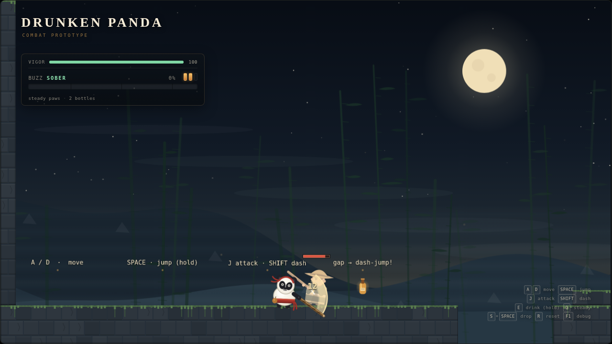

# Drunken Panda

A wobbly panda martial artist drinks his way through a side-scrolling metroidvania.
This repository is the **combat prototype**: one test course, four levels of
inebriation, a three-hit staff combo, and three sober monks who object to all of it.



Built with **Excalibur.js 0.32**, TypeScript, Vite and pnpm. Everything is client-side;
there is no backend.

## Run it

```bash
pnpm install
pnpm dev
```

Then open the printed local URL.

```bash
pnpm test       # headless movement / buzz / combat / enemy tests
pnpm typecheck
pnpm build      # static production build in dist/
pnpm preview
```

## Controls

| Action | Keyboard | Gamepad |
| --- | --- | --- |
| Move | `A` / `D` or arrows | Left stick / D-pad |
| Jump | `Space`, `W` or `Up` | Face 1 (A) |
| Attack | `J` or `Z` | Face 3 (X) / right bumper |
| Dash | `Shift` or `K` | Face 2 (B) / left bumper |
| Drink (hold) | `E` | Face 4 (Y) / right trigger |
| Steady yourself | `Q` (hold) | Left trigger |
| Drop through planks | `S` + `Space` | Down + jump |
| Reset the course | `R` | Select |
| Debug | `F1` | — |

## What the prototype proves

- **Movement:** acceleration and friction, variable-height jump, coyote time,
  jump buffering, apex hang, ceiling corner correction, one-way platforms with
  drop-through, a committed dash with one air dash, and a forgiving checkpoint.
- **Combat:** a three-hit staff combo with active hitbox windows and queued
  follow-ups, buzz-scaled damage and reach, hitstop, damage numbers, knockback,
  i-frames and a blackout/respawn loop. Enemies telegraph with a raised staff and
  a red `!`, then sweep a staff of their own.
- **The Buzz meter:** four bands with real mechanical differences. Drinking is a
  deliberate risk/reward choice: it raises outgoing damage and reach while also
  raising incoming damage. Tea sobers you up, heals, and refills bottles.
- **The wobble:** a procedural panda rig with springy head lag, run cycle,
  squash/stretch, blinking, drinking and staff-swing animations, band-dependent
  sway, blush, stars, camera sway and a screen tint.
- **Feel tooling:** a live debug overlay, collision visualisation, a 120 Hz fixed
  simulation step, deterministic unit tests, and runtime access to every tunable
  through `window.__panda`.

### The Sober Monk

A green-robed tea-totaler with a straw hat and a long staff. He patrols a platform,
turns at ledges, chases when the panda gets close, and commits to a 0.45 s wind-up
before each swing. Hitting him staggers him; enough hits and he drops a sip of buzz.
Three of them guard the course: the starting ground, the gate after the second pit,
and the tea house approach.

### Combat numbers

- Player: 100 vigor, 0.9 s i-frames, 0.28 s hit-stun, 270 px/s knockback.
- Staff combo: 12 / 14 / 22 base damage, active for 0.10 / 0.10 / 0.14 s.
- Buzz damage multiplier: 1.00 / 1.08 / 1.22 / 1.38, with +0 / +4 / +8 / +12 px reach.
- Incoming damage multiplier: 1.00 / 1.00 / 1.15 / 1.30.
- Sober Monk: 70 health, 14 damage, 300 px aggro, 0.45 s wind-up, 0.9 s attack cooldown.
- Kill reward: +8 buzz. Hitstop: 50 ms light, 90 ms finisher, 75 ms when hurt.

### Buzz bands

| Band | Range | Speed | Damage | Taken | Sway | Drift | Flavour |
| --- | --- | --- | --- | --- | --- | --- | --- |
| Sober | 0–24 | 1.00x | 1.00x | 1.00x | 1 px | none | steady paws |
| Tipsy | 25–54 | 1.08x | 1.08x | 1.00x | 3 px | 7 px/s | loose and limber |
| Drunk | 55–84 | 1.15x | 1.22x | 1.15x | 7 px | 16 px/s | the wobble sets in |
| Wasted | 85–100 | 1.22x | 1.38x | 1.30x | 12 px | 28 px/s | absolute unit |

Buzz decays at 1.6/s. A drink takes 0.7 s, fills 30 buzz and consumes one of three
bottles. Starting bottles: 2. Bottles are picked up on the course and refilled at
the tea house. Holding `Q` steadies the sway and drift at the cost of speed.
The tea house also heals 25 vigor per second and sets up the next fight.

## The test course

A single 3840 px room with a checkpoint every 0.5 s while grounded:

1. Run/jump tutorial and the first bottle.
2. A 200 px pit that needs a dash-jump.
3. A staircase, then four one-way planks over a second pit.
4. Low ceilings for head-bonk and corner-correction testing.
5. A vertical climb to a high bottle.
6. A tea house that sobers you, heals you, and refills bottles.

Three Sober Monks patrol the first ground, the gate after the second pit, and the
tea-house approach. Falling respawns you at your last safe footing without draining
buzz. Running out of vigor blacks you out: you wake at the checkpoint with full
health, sober, and all enemies reset. `R` resets the course, bottles, pickups, health,
buzz and enemies.

## Architecture

```
src/
  game/
    config.ts                all gameplay tunables
    input/InputMap.ts         keyboard + gamepad action map, edge detection
    physics/aabb.ts           pure AABB helpers
    physics/kinematic.ts      fixed-step collision resolution
    player/PlayerController.ts pure movement + combat state machine
    player/PandaRig.ts        procedural Canvas 2D panda animation
    player/PlayerActor.ts     Excalibur actor that renders the rig
    enemies/EnemyController.ts pure patrol/chase/telegraph/attack AI
    enemies/EnemyRig.ts       procedural Sober Monk animation
    enemies/EnemyActor.ts     Excalibur actor for the monk
    systems/Buzz.ts           pure buzz meter and band effects
    level/room.ts             test course data (collision + props)
    level/terrainArt.ts       generated stone/wood/tea-house art
    level/background.ts       cached parallax sky/mountains/bamboo
    fx/Particles.ts           dust, sparks, damage numbers, steam, motes
    audio/Sfx.ts              synthesized WebAudio effects
    ui/Hud.ts                 DOM HUD overlay
    scenes/GameScene.ts       course assembly and game loop
  main.ts
tests/                       43 headless tests
```

### Key decisions

- **Custom kinematic controller, not engine physics.** `PlayerController`,
  `EnemyController` and `kinematic.ts` share a pure fixed-step AABB solver with no
  Excalibur imports. Physics runs at 120 Hz and can be replayed in Vitest. This
  keeps platforming deterministic and avoids collision jitter.
- **Scene-level hitstop.** A hit briefly freezes the whole simulation while the
  renderer keeps drawing, which makes impacts read as crunchy without adding time
  scaling to every system.
- **Procedural placeholder art.** The panda is drawn every frame into a small
  `ex.Canvas`; terrain and parallax layers are generated once into cached Canvas
  graphics. Replacing them with sprite sheets later is a localized change.
- **Client-only.** No server, no accounts. The only persistence planned for later
  is `localStorage` for checkpoints/abilities.
- **HTML HUD over Excalibur ScreenElements.** Text stays crisp at any resolution
  and the bar/tint transitions are trivial CSS.

## Tuning and debugging

Add `?debug` to the URL, or press `F1` at any time, to show collision outlines and
the debug panel. Useful runtime handles:

```js
__panda.buzz.value = 90;              // jump to WASTED
__panda.buzz.bottles = 3;
__panda.controller.teleport(2900, 400);
__panda.controller.health = 40;
__panda.enemies[0].actor.controller.health = 1;
__panda.scene.camera.pos.setTo(2900, 360);
__panda.config.PHYSICS.dashSpeed = 760; // live tune (reload to fully reset)
__panda.config.COMBAT.enemyDamage = 6;
```

All starting values live in `src/game/config.ts`. The unit tests are the contract
for feel features such as coyote time, jump buffering, one-way platforms and dash
rules.

## Tests

```bash
pnpm test
```

Coverage includes:

- Buzz band thresholds, drinking, decay, tea, focus multipliers.
- AABB overlap semantics.
- Falling/landing, jump height, jump cut, coyote time, jump buffering.
- Dash speed/cooldown and the one-air-dash limit.
- One-way landing, upward pass-through and drop-through.
- Head bonks, ceiling corner correction, wall collision.
- Drink completion/cancel/denial, drunk speed, focus slowdown.
- Attack hitbox windows, damage/reach scaling with buzz, queued three-hit combos.
- Taking damage: stagger, knockback, i-frames, heal cap, reset.
- Enemy patrol bounds, ledge turning, aggro, wind-up, attack hitbox, stagger, death
  and reset.
- The course's 200 px dash-jump and the first plank drop.

## Deliberately out of scope for this milestone

Bosses, a second enemy archetype, room transitions, saves, menus, parry mechanics,
real audio/art, mobile touch and metroidvania ability gates.

## Next

1. A small room graph with camera transitions and a tea-house save point.
2. A second enemy: a ranged tea-thrower, then a mini-boss.
3. Parry/perfect-dodge mechanics and a proper combo finisher.
4. Art/audio pass and a title screen.

The panda's working name is **Master Bao**. He has not yet been consulted.
